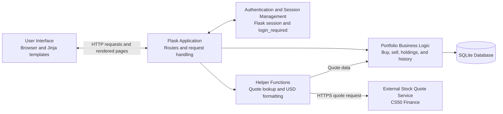
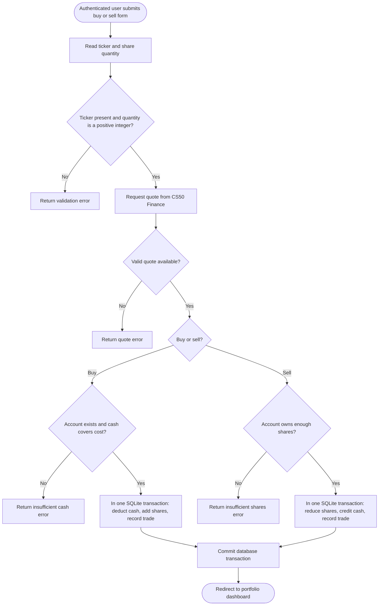
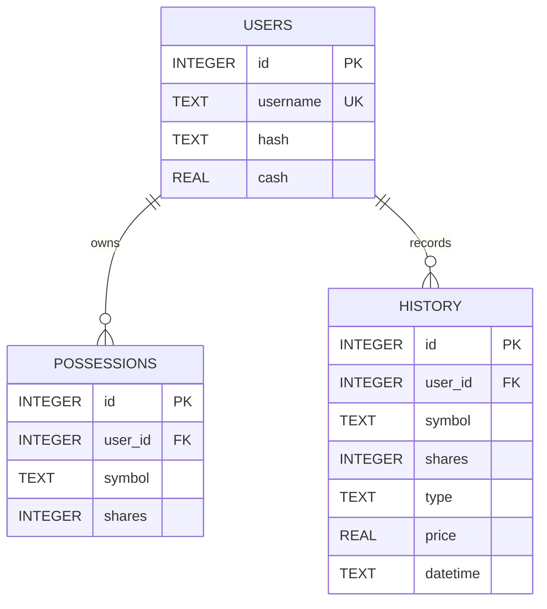

# Flask Stock Portfolio

Flask Stock Portfolio is a web application for managing a simulated stock portfolio. Users can register and log in, retrieve stock quotes, buy and sell shares, review their holdings and transaction history, and track their available cash and estimated portfolio value. User accounts, cash balances, holdings, and trades are persisted in SQLite.

The project originated as an adaptation of the Finance assignment from CS50x. It has since been adapted for this portfolio to use SQLite directly, without the `cs50` library or the educational session extensions.

> This is an educational simulation. It does not place real trades or provide brokerage services.

## Features

- User registration and login with Werkzeug password hashing.
- Stock quote lookup through the CS50 Finance quote service.
- Share purchases and sales with cash and holdings updates.
- Portfolio overview with current quote-based estimates, cash, and total value.
- Per-user transaction history.
- Automatic creation of the SQLite database tables when the application starts.

## Technology

- Python and Flask
- SQLite
- Jinja templates and Bootstrap 5.3.3 (loaded from jsDelivr)
- `requests` for the external quote request

## Screenshots

No application screenshots are currently included in the repository. Useful additions would be:

- Login and registration pages
- Main portfolio dashboard
- Stock quote lookup and result
- Transaction history

## System Architecture



The browser submits forms to Flask routes, which render Jinja templates or redirect after an action. Flask's session stores the logged-in user's ID, and `login_required` protects portfolio, quote, buy, sell, and history routes. Route handlers perform the portfolio operations and use SQLite queries scoped by that user ID. The `helpers.py` module requests stock quote data from CS50 Finance and formats currency values for templates. The database connection is opened per application context and closed during teardown.

## Transaction Workflow

For a purchase, the user submits a ticker symbol and a positive whole-number share quantity. The application normalizes the symbol, retrieves a quote, calculates the cost, and checks that the user's cash balance covers it. Within a SQLite connection transaction, it deducts the cost, inserts or increases that user's holding, and records the trade with its quote price and UTC timestamp. A successful transaction redirects to the portfolio dashboard.

For a sale, the user selects a symbol from their holdings and submits a positive whole-number quantity. After retrieving a quote, the application checks that the user owns enough shares. Within a SQLite transaction, it reduces or removes the holding, credits the proceeds to cash, and records the sale. A successful transaction redirects to the dashboard.

SQLite commits the grouped database changes together when the transaction context exits successfully; a database error causes the transaction to roll back and the route returns an error response. Input checks reject empty symbols and non-positive or non-integer share quantities. Unknown or unavailable quotes are rejected. The handlers check the cash balance and share count before applying a trade.

The account and holding checks are application-side reads and are not explicitly serialized against simultaneous trade requests. Concurrent requests may race while checking balances or holdings; stronger concurrency guarantees would require a database-level conditional update or explicit write transaction.



## Authentication and Security

- Registration stores a password hash generated by `werkzeug.security.generate_password_hash`; login checks it with `check_password_hash`. Passwords are not stored in plaintext.
- Successful login clears the prior session and stores `user_id`; logout clears the session. Flask's default session mechanism uses a signed client-side cookie.
- The `login_required` decorator protects the portfolio, quote, buy, sell, and history routes. Registration and login remain public.
- Database queries for holdings, cash, and history are filtered by the authenticated user's ID. Foreign keys connect user-owned records to `users`, and SQLite foreign-key enforcement is enabled on each connection.
- SQL values from requests are passed as query parameters. Share quantities are parsed as positive integers, and quote failures are returned as application errors.
- `SESSION_COOKIE_HTTPONLY` and `SESSION_COOKIE_SAMESITE="Lax"` are configured. Responses also receive no-cache headers.
- `SECRET_KEY` can be supplied through the environment. The code falls back to `dev-key-change-before-deploying`, so deployments must set a private, unpredictable key.

The code does not implement CSRF tokens, rate limiting, or a password complexity policy. Username validation currently checks only that the value is non-empty; duplicate usernames are rejected by the database's unique constraint. These limits are relevant when considering any use beyond local educational purposes.

## Database Design

The application initializes its tables with `CREATE TABLE IF NOT EXISTS` when `app.py` is imported, including when Flask starts the app. By default, the database file is `finance.db` beside `app.py`; `DATABASE_PATH` can override its path.



- `users` stores the unique username, password hash, and cash balance. New accounts start with a `$10,000.00` simulated balance.
- `possessions` stores each user's current share count by symbol. `(user_id, symbol)` is unique, and `shares` must be positive.
- `history` stores each buy or sell as a separate row, including symbol, share quantity, transaction type, quote price, and UTC timestamp.
- Both `possessions.user_id` and `history.user_id` reference `users.id` with `ON DELETE CASCADE`.
- Cash balances and quote prices use SQLite `REAL` values.

Cash is stored on the user record, current holdings are stored in `possessions`, and the transaction ledger is stored in `history`. Portfolio market values are calculated at request time from current quotes rather than stored in the database.

## Stock Quotes

`helpers.lookup` sends an HTTPS GET request to `https://finance.cs50.io/quote` with the ticker in the `symbol` parameter. It reads `companyName` and `latestPrice` from the JSON response and returns them with the normalized ticker. The portfolio uses the returned price to estimate holdings and total value; quote lookup, buying, and selling require an internet connection.

The request has an eight-second timeout. HTTP errors, request failures, missing response fields, and values that cannot be converted to a number are handled by returning `None`; routes then show an error for unavailable or unrecognized quotes. The returned price is used for the simulated transaction and portfolio estimate. On the portfolio dashboard, a holding whose quote lookup fails is omitted from the rendered rows and the total estimate for that request. Market data may be delayed, as indicated in the application footer.

## Project Structure

```text
app.py                 Flask routes, authentication, database setup, and portfolio logic
helpers.py             External quote lookup and currency formatting
requirements.txt       Python dependencies
templates/             Jinja pages for authentication, portfolio, quotes, trades, and errors
static/styles.css      Application-specific styles
finance.db             Created automatically at runtime; not tracked in the repository
```

## Development and Testing

Requires Python 3.10 or newer.

```bash
git clone <repository-url>
cd flask-stock-portfolio
python -m venv .venv
source .venv/bin/activate        # Windows: .venv\Scripts\activate
pip install -r requirements.txt
```

Configure the Flask session key before running the app. Optionally set a custom database path. For development mode with automatic reload, set `FLASK_DEBUG=1`.

```bash
export SECRET_KEY="a-long-random-secret-key"
# Optional: export DATABASE_PATH="/path/to/finance.db"
export FLASK_DEBUG=1
flask --app app run
```

In Windows PowerShell, set variables with `$env:SECRET_KEY="a-long-random-secret-key"`, `$env:DATABASE_PATH="C:\path\to\finance.db"`, and `$env:FLASK_DEBUG="1"`. Open <http://127.0.0.1:5000> and register an account.

There is no automated test suite in the repository. Useful tests would cover registration and login, route access without authentication, quote failures, cash and share validation, buy/sell balance changes, per-user data isolation, and rollback behavior when a transaction fails.

## Credits and Acknowledgments

This project is based on the Finance assignment from [CS50x](https://cs50.harvard.edu/x/). It has been adapted for this portfolio with direct SQLite persistence and without the `cs50` library or the educational session extensions. Stock quotes are retrieved from the [CS50 Finance quote service](https://finance.cs50.io/).
